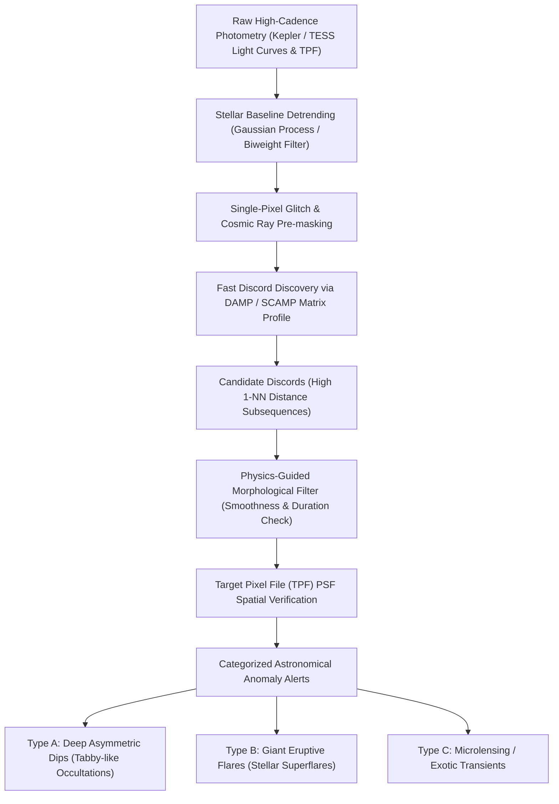

# Astro-Discord: Khai phá Dị thường Thiên văn bằng Physics-Guided Time Series Discords

> **Dự án nghiên cứu:** Phát hiện hiện tượng dị thường chớp nhoáng và che khuất kỳ dị (Astronomical Transients & Complex Occultation Anomalies) trong chuỗi thời gian quang thông kính thiên văn vũ trụ (Kepler, TESS) thông qua thuật toán Discord Discovery có hướng dẫn vật lý.  
> **Lĩnh vực:** Khai phá dữ liệu chuỗi thời gian (Time-Series Data Mining) $\times$ Vật lý thiên văn quan sát (Observational Astrophysics).  
> **Mục tiêu công bố:** ACM KDD, IEEE TKDE, SIAM SDM, hoặc *Monthly Notices of the Royal Astronomical Society (MNRAS)* / *Astronomy and Computing*.

---

## 1. Đặt vấn đề & Bản chất khoa học (The Core Thesis)

### 1.1. Khát vọng săn lùng "Unknown Unknowns" trong Vũ trụ
* Trong thiên văn học hiện đại, các mô hình học máy có giám sát (Supervised Learning như CNN, Random Forest) chỉ nhận diện được những gì **đã biết trước** (Known Knowns) dựa trên tập dữ liệu đã gán nhãn: hành tinh tuần hoàn chuẩn, sao biến quang nhị phân (Eclipsing Binaries), sao xung biến quang (Cepheids).
* Tuy nhiên, những khám phá vĩ đại nhất lịch sử thiên văn lại là **những hiện tượng chưa từng thấy trong sách giáo khoa (Unknown Unknowns)**:
  1. **Ngôi sao Boyajian (Tabby's Star - KIC 8462852):** Bị sụt giảm quang thông tới 22% một cách phi đối xứng, phi chu kỳ, kéo dài nhiều ngày (từng làm dấy lên giả thuyết về công trình Dyson Sphere của nền văn minh ngoài Trái Đất).
  2. **Hành tinh đá đang bốc hơi (Disintegrating Rocky Exoplanets - KIC 12557548b):** Bị sao mẹ nung chảy, đuôi bụi phía sau thay đổi hình dạng liên tục theo từng vòng quay khiến mỗi lần sụt giảm quang thông lại mang một hình thái dị thường khác nhau.
  3. **Siêu bão từ sao (Stellar Superflares):** Bùng phát năng lượng đột ngột gấp hàng nghìn lần bão Mặt Trời.
  4. **Hiện tượng vi thấu kính hấp dẫn (Gravitational Microlensing):** Ánh sáng sao bị bẻ cong và khuếch đại khi một thiên thể vô hình đi ngang qua.

### 1.2. Time Series Discords: Vũ khí tối thượng của Unsupervised Anomaly Detection
* **Định nghĩa Discord (Keogh et al.):** Là đoạn con (subsequence) trong chuỗi thời gian có khoảng cách tới láng giềng gần nhất (1-Nearest Neighbor distance) là **lớn nhất**.
* Discord đại diện cho hình thái cô độc nhất, khác biệt nhất và không lặp lại theo bất kỳ quy luật nào trong quá khứ $\implies$ Hoàn toàn phù hợp để bắt trọn các sự kiện dị thường thiên văn độc nhất mà không cần dữ liệu huấn luyện nhãn.

### 1.3. Tử huyệt của Discord Discovery trong Thiên văn học (Reality Check)
Nếu áp dụng thuật toán Discord thuần túy lên dữ liệu kính viễn vọng không gian, **99.9% Top Discords sẽ là báo động giả (False Alarms)** do rác cảm biến:
1. **Tia vũ trụ (Cosmic Ray Hits):** Các hạt mang năng lượng cao va chạm trực tiếp vào pixel của cảm biến CCD/CMOS, tạo ra một đỉnh nhọn cực lớn bất thường chỉ kéo dài đúng 1 nhịp lấy mẫu ($T_{\text{dur}} = 1$ cadence).
2. **Rung động cơ kính (Spacecraft Thruster Firings & Momentum Dumps):** Kính viễn vọng giật cơ học để cân bằng bánh đà, làm đường cong quang thông nhảy vọt một đoạn dị thường.
3. **Phản xạ ánh sáng mặt trời/mặt trăng (Stray Light / Glints).**

$\implies$ **Đóng góp cốt lõi của đề tài:** Không dùng Discord mù quáng, mà đề xuất khung **Physics-Guided Discord Discovery (PG-Discord)**: kết hợp sức mạnh thuật toán Matrix Profile với các tiên nghiệm vật lý quang học (Physical & Optical Priors) để triệt tiêu toàn bộ rác cảm biến, chỉ giữ lại các dị thường vật lý thiên văn thực thụ.

---

## 2. Mô hình toán học & Tiên nghiệm Vật lý

### 2.1. Định nghĩa Toán học về Time Series Discord
Cho chuỗi thời gian quang thông đã khử xu hướng $S = (s_1, s_2, \dots, s_N)$ và độ dài cửa sổ dị thường $m$:
* Khoảng cách $z$-normalized Euclidean tới láng giềng gần nhất ngoài vùng loại trừ $w$:
  $$D_S[i] = \min_{j \neq i, |j-i| > w} \|\hat{T}_{i, m} - \hat{T}_{j, m}\|_2$$
* **Top-1 Discord** là vị trí:
  $$i^* = \arg\max_{i} D_S[i]$$

### 2.2. Các Bộ lọc Tiên nghiệm Vật lý (Physics-Guided Priors)
Để một đoạn con ứng viên $T_{i, m}$ được công nhận là **Astrophysical Discord** (Dị thường Vật lý Thiên văn), nó phải vượt qua 3 điều kiện ràng buộc:

1. **Ràng buộc Thời lượng Tối thiểu (Temporal Extent Prior):**
   * Các quá trình vật lý thiên văn (che khuất, bão từ, thấu kính) chịu giới hạn cơ học thiên thể và quang cầu sao, không thể diễn ra tức thời trong 1 nhịp lấy mẫu:
     $$\Delta t_{\text{event}} \ge \tau_{\text{min}} \quad (\text{với TESS: } \tau_{\text{min}} \ge 30 \text{ phút} \approx 15 \text{ điểm cadences})$$
   * Nếu sự kiện chỉ kéo dài $\le 2$ điểm liên tiếp $\implies$ Gán nhãn là **Cosmic Ray** và gạt bỏ.

2. **Ràng buộc Tính trơn mượt Đạo hàm (Morphological Smoothness Prior):**
   * Xung quang học do tia vũ trụ có đạo hàm bước nhảy gần như thẳng đứng ($\frac{ds}{dt} \to \infty$).
   * Hiện tượng thiên văn có đường cong mượt do diện tích che khuất thay đổi liên tục:
     $$\max_{k} \left| s_{i+k+1} - s_{i+k} \right| \le \gamma \cdot \operatorname{IQR}(S)$$

3. **Ràng buộc Điểm ảnh đa kênh (Multi-Pixel Aperture Consistency Prior):**
   * Kính viễn vọng ghi nhận ma trận điểm ảnh mục tiêu (Target Pixel File - TPF).
   * Dị thường vật lý phải xuất hiện đồng bộ trên hàm tán xạ điểm (Point Spread Function - PSF) gồm nhiều pixel xung quanh ngôi sao. Nếu đột biến chỉ xảy ra trên **đúng 1 pixel đơn lẻ**, đó là lỗi điểm chết (bad pixel) hoặc tia vũ trụ.

---

## 3. Kiến trúc Hệ thống (`Astro-Discord` Pipeline)



---

## 4. Thiết kế Thực nghiệm Chuẩn Quốc tế (Experimental Protocol)

Để bài báo có sức nặng học thuật tuyệt đối, phần thực nghiệm cần thiết kế thành 4 phần kiểm toán:

### Kịch bản 1: Khả năng Khôi phục Dị thường Đã biết (Sanity Check trên Historical Anomalies)
Chạy thuật toán trên dữ liệu thô của các hiện tượng dị thường nổi tiếng trong lịch sử NASA:
1. **KIC 8462852 (Tabby's Star):**
   * *Nhiệm vụ:* Thuật toán có tự động đánh dấu sự kiện sụt giảm quang thông bí ẩn tại Ngày Kepler 792 và Ngày 1519 thành **Top-1 Discord** của toàn bộ 4 năm quan sát hay không?
2. **KIC 12557548b (Disintegrating Exoplanet):**
   * *Nhiệm vụ:* Bắt trọn các lần transit có đuôi bụi dị hình bất đối xứng mà các bộ dò tìm hành tinh chuẩn (BLS) bị nhiễu.
3. **Danh mục Siêu bão từ Kepler (Superflare Catalog - Shibayama et al., 2013):**
   * Đo độ nhạy (Recall) trong việc bắt các siêu bão từ năng lượng lớn.

### Kịch bản 2: Khả năng Chống Nhiễu & Lọc Báo động Giả (False Alarm Rejection Test)
* **Phương pháp:** Tiêm nhân tạo 10,000 sự kiện rác cảm biến:
  * 5,000 xung tia vũ trụ (single-pixel spikes).
  * 5,000 nhịp giật kính viễn vọng (thruster drift steps).
* **Đối thủ so sánh:**
  * Vanilla Discord Discovery (STOMP / DAMP không có lọc vật lý).
  * Isolation Forest (iForest).
  * Autoencoder chuỗi thời gian (LSTM-AE).
  * `Astro-Discord` (Đề xuất có Physics-Guided Priors).
* **Metric:** False Positive Rate (FPR) và Precision-Recall AUC (PR-AUC).
* **Kỳ vọng:** Vanilla Discord và iForest có tỷ lệ báo động giả $>80\%$, trong khi `Astro-Discord` giảm FPR xuống $<2\%$.

### Kịch bản 3: Tốc độ Thực thi Streaming trên Dữ liệu Quy mô Lớn (Scalability)
* Sử dụng thuật toán **DAMP (Discord Aware Matrix Profile)** hoặc **SCAMP** trên GPU.
* So sánh thời gian xử lý khi quét toàn bộ kho lưu trữ 200,000 ngôi sao của TESS.
* Chứng minh hệ thống có thể xử lý luồng dữ liệu thời gian thực (Real-time alert latency $< 1$ giây cho mỗi light curve 30 ngày).

---

## 5. Ngăn xếp Công nghệ & Mã nguồn Khởi động (Python Prototype)

### Cài đặt môi trường:
```bash
pip install lightkurve stumpy astropy numpy matplotlib scipy
```

### Script thực nghiệm nhanh trên Ngôi sao Dị thường KIC 8462852 (Tabby's Star):
```python
import lightkurve as lk
import numpy as np
import stumpy
import matplotlib.pyplot as plt

# 1. Tải dữ liệu Kepler Quý 8 của Ngôi sao Boyajian (KIC 8462852)
print("Đang tải dữ liệu KIC 8462852 (Tabby's Star)...")
search_result = lk.search_lightcurve('KIC 8462852', author='Kepler', quarter=8)
lc = search_result.download().remove_nans().normalize()

time = lc.time.value
flux = lc.flux.value

# 2. Khử xu hướng đường nền bằng median filter trượt
window_size = 101
trend = np.convolve(flux, np.ones(window_size)/window_size, mode='same')
clean_flux = flux - trend

# 3. Tính Matrix Profile để tìm Discord (Cửa sổ m = 48 điểm ~ 24 giờ)
m = 48
mp = stumpy.stump(clean_flux, m)

# 4. Tìm Top-1 Discord (Đoạn con có khoảng cách tới 1-NN lớn nhất)
discord_idx = np.argmax(mp[:, 0])
discord_distance = mp[discord_idx, 0]

print(f"Top 1 Discord phát hiện tại vị trí {discord_idx} (Thời gian: {time[discord_idx]:.2f})")
print(f"Khoảng cách 1-NN cực đại: {discord_distance:.4f}")

# 5. Vẽ hình minh họa
fig, axs = plt.subplots(2, 1, figsize=(12, 6), sharex=True)
axs[0].plot(time, flux, color='black', lw=0.8, label='Quang thông KIC 8462852')
axs[0].axvspan(time[discord_idx], time[discord_idx + m], color='red', alpha=0.3, label='Dị thường Discord')
axs[0].set_ylabel('Quang thông Chuẩn hóa')
axs[0].legend()

axs[1].plot(time[:len(mp)], mp[:, 0], color='blue', lw=0.8, label='Matrix Profile (Distance)')
axs[1].axvline(time[discord_idx], color='red', linestyle='--', label='Đỉnh Discord')
axs[1].set_xlabel('Thời gian Kepler (BJD - 2454833)')
axs[1].set_ylabel('Khoảng cách 1-NN')
axs[1].legend()

plt.tight_layout()
plt.savefig('tabby_discord_demo.png', dpi=300)
print("Đã lưu đồ thị demo vào file tabby_discord_demo.png")
```

---

## 6. Lộ trình Triển khai Dự án (Action Roadmap)

- [ ] **Giai đoạn 1 (Tuần 1 - 2): Thử nghiệm trên các Dị thường Lịch sử**
  * Tải và chạy thử nghiệm thuật toán trên KIC 8462852 (Tabby's Star) và KIC 12557548b.
  * Đánh giá xem Top Discords có trùng khớp với báo cáo của các nhà thiên văn hay không.
- [ ] **Giai đoạn 2 (Tuần 3 - 4): Xây dựng Bộ lọc Tiên nghiệm Vật lý (Physics-Guided Priors)**
  * Cài đặt bộ lọc kiểm tra độ rộng xung $\tau_{\text{min}}$ và tính trơn mượt đạo hàm để loại bỏ Cosmic Rays.
  * Tích hợp kiểm tra đồng bộ không gian trên Target Pixel File (TPF).
- [ ] **Giai đoạn 3 (Tuần 5 - 6): Thử nghiệm Kháng Nhiễu & Benchmark Mở rộng**
  * Tạo bộ dữ liệu tiêm 10,000 xung rác cảm biến nhân tạo.
  * Đánh giá và so sánh PR-AUC với Isolation Forest và Autoencoders.
- [ ] **Giai đoạn 4 (Tuần 7 - 8): Soạn thảo Bài báo Khoa học**
  * Viết bản thảo theo chuẩn tạp chí thiên văn/khoa học máy tính quốc tế.
  * Xuất bản mã nguồn mở trọn gói trên GitHub.

---

## 7. Tài liệu Tham khảo Cốt lõi (Key References)
1. **Boyajian, T. S., et al. (2016).** Planet Hunters IX. KIC 8462852 - where's the flux?. *Monthly Notices of the Royal Astronomical Society*, 457(4), 3988-4004. (Bài báo gốc về Ngôi sao Boyajian).
2. **Rappaport, S., et al. (2012).** Possible disintegrating short-period super-Mercury associated with KIC 12557548. *The Astrophysical Journal*, 752(1), 1. (Bài báo gốc về hành tinh đá bốc hơi).
3. **Zhu, Y., et al. (2018).** Matrix Profile II: Exploiting a Novel Measure of Similarity to Discover Non-Trivial Time Series Motifs and Discords. *IEEE ICDM 2018*.
4. **Lu, Y., et al. (2022).** DAMP: Discord Aware Matrix Profile. *arXiv:2203.12596*. (Thuật toán tìm Discord siêu tốc độ mới nhất).
5. **Shibayama, T., et al. (2013).** Superflares on solar-type stars observed with Kepler I. Statistical properties of five hundred superflares. *The Astrophysical Journal Supplement Series*, 209(1), 5.
