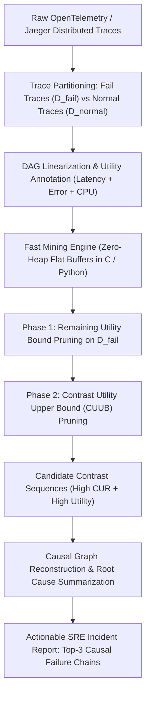

# Trace-Cause: Khai phá Chuỗi Nhân quả Lỗi trong Microservices bằng Contrast High-Utility Mining

> **Dự án nghiên cứu:** Phân tích nguyên nhân gốc rễ (Root Cause Analysis - RCA) có khả năng giải thích nhân quả tường minh trong hệ thống Microservices quy mô lớn thông qua khai phá mẫu tương phản có độ hữu dụng cao (Contrast High-Utility Sequence Mining).  
> **Lĩnh vực:** Khai phá dữ liệu (Data Mining) $\times$ Vận hành thông minh (AIOps) $\times$ Kỹ nghệ phần mềm & Hệ thống phân tán (Distributed Systems / Software Engineering).  
> **Mục tiêu công bố:** ACM KDD (Applied Data Science), IEEE TKDE, ACM FSE, IEEE/ACM ICSE, hoặc USENIX ATC.

---

## 1. Đặt vấn đề & Bản chất khoa học (The Core Thesis)

### 1.1. Cuộc khủng hoảng Root Cause Analysis (RCA) trong Cloud Microservices
* Các hệ thống Microservices hiện đại (Netflix, Uber, Shopee, các ngân hàng số) bao gồm hàng trăm dịch vụ độc lập giao tiếp qua RPC/gRPC/REST.
* Mỗi yêu cầu của người dùng sinh ra một cây vết thực thi phân tán (**Distributed Trace**) gồm hàng chục đến hàng trăm đoạn xử lý con (**Spans**).
* **Vấn đề thực tế khi xảy ra sự cố (Outages / Latency Spikes):**
  * Lỗi thường lan truyền dây chuyền (Cascading Failure): Dịch vụ A bị nghẽn $\to$ Dịch vụ B gọi A bị timeout $\to$ Dịch vụ C thử lại liên tục (Retry Storm) $\to$ Toàn bộ API Gateway sập với mã lỗi 504.
  * Các mô hình Deep Learning hiện tại (GNN, LSTM, Transformer) hoặc mô hình phát hiện bất thường (TraceAnomaly, DeepLog) chỉ có thể đưa ra cảnh báo: *"Hệ thống đang lỗi với xác suất 99%"* hoặc bôi đỏ một vài dịch vụ nghi vấn.
  * **Hộp đen hoàn toàn:** Kỹ sư SRE không thể biết được **trình tự diễn tiến nhân quả chính xác** đã kích hoạt sự cố. Việc đào bới thủ công hàng triệu span phân tán tiêu tốn hàng giờ đồng hồ, làm tăng chỉ số thời gian phục hồi (Mean Time to Resolution - MTTR).

### 1.2. Giải pháp Đột phá: Contrast High-Utility Sequence Mining
* Thay vì khai phá mẫu phổ biến (Frequent Patterns) — vốn chỉ toàn các vết bình thường chiếm 99% lưu lượng, ta chia vết thực thi thành 2 tập:
  * $\mathcal{D}_{\text{fail}}$: Tập các vết bị lỗi (HTTP 5xx) hoặc có độ trễ vượt SLA (Latency Spikes).
  * $\mathcal{D}_{\text{normal}}$: Tập các vết thực thi bình thường thành công.
* **Mục tiêu thuật toán:** Tìm các chuỗi sự kiện thỏa mãn đồng thời 2 điều kiện:
  1. **Độ tương phản áp đảo (High Contrast):** Xuất hiện phổ biến trong tập lỗi $\mathcal{D}_{\text{fail}}$, nhưng **hầu như biến mất** trong tập bình thường $\mathcal{D}_{\text{normal}}$.
  2. **Độ hữu dụng chi phí cao (High Utility):** Mỗi mắt xích mang trọng số thiệt hại thực tế: **độ trễ tích lũy ($dur$ tính bằng ms)** và **mức tiêu hao tài nguyên (CPU/RAM spikes)**.
* **Đầu ra mong muốn:** Một chuỗi nhân quả ngắn gọn, minh bạch 100%:
  $$\text{Root-Cause Chain: } [\text{Cart: DB\_Pool\_Exhaust}] \xrightarrow{>2.5s} [\text{Order: Retry\_Storm}] \xrightarrow{504} [\text{Gateway: Circuit\_Breaker}]$$

---

## 2. Mô hình Toán học & Đóng góp Lý thuyết (Theoretical Novelty)

### 2.1. Tuyến tính hóa Cây Vết thực thi (Trace Linearization)
Một vết phân tán là một đồ thị có hướng không chu trình (DAG). Mỗi span $e = (\text{service}, \text{operation}, t_{\text{start}}, t_{\text{end}}, \text{status}, \text{cost})$.  
Ta tuyến tính hóa vết thành chuỗi sự kiện theo trật tự thời gian nhân quả:
$$T = \langle e_1, e_2, \dots, e_k \rangle, \quad t_{\text{start}}(e_1) \le t_{\text{start}}(e_2) \le \dots \le t_{\text{start}}(e_k)$$
Trọng số hữu dụng của span $e$ phản ánh mức độ đóng góp vào sự cố:
$$u(e) = \text{duration}(e) + \lambda_1 \cdot \mathbb{I}(\text{status}(e) \neq 200) + \lambda_2 \cdot \Delta\text{CPU}(e)$$

### 2.2. Tỷ số Tương phản Hữu dụng (Contrast Utility Ratio - CUR)
Độ hữu dụng của chuỗi sự kiện $\alpha = \langle a_1, a_2, \dots, a_m \rangle$ trong tập dữ liệu $\mathcal{D}$ là:
$$u(\alpha, \mathcal{D}) = \sum_{T \in \mathcal{D}, \alpha \sqsubseteq T} u(\alpha, T)$$

Tỷ số tương phản hữu dụng giữa tập lỗi và tập bình thường:
$$\operatorname{CUR}(\alpha) \triangleq \frac{u(\alpha, \mathcal{D}_{\text{fail}})}{u(\alpha, \mathcal{D}_{\text{normal}}) + \epsilon}$$

### 2.3. Thách thức Phi đơn điệu 2 chiều & Cận trên CUUB
* Khi mở rộng chuỗi $\alpha \to \beta = \alpha \cdot e$:
  * Tử số $u(\beta, \mathcal{D}_{\text{fail}})$ giảm.
  * Mẫu số $u(\beta, \mathcal{D}_{\text{normal}})$ cũng giảm.
  * Do đó, $\operatorname{CUR}(\beta)$ **phi đơn điệu** (có thể bất ngờ tăng vọt lên), khiến việc cắt tỉa nhánh đệ quy gặp thách thức toán học lớn!

#### Giải pháp Đột phá: Chiến lược Cắt tỉa 2 Pha với Cận trên CUUB (Contrast Utility Upper Bound)
1. **Pha 1 (Lọc Hữu dụng trên Tập Lỗi):**
   * Ràng buộc chuỗi nguyên nhân phải có tổng thiệt hại đáng kể trên tập lỗi: $u(\alpha, \mathcal{D}_{\text{fail}}) \ge \mu_{\text{fail}}$.
   * Áp dụng cận dư thời lượng (**Remaining Utility Bound - RUB**) tương tự cơ chế của thuật toán AURA/FastHUEM để cắt tỉa không gian tìm kiếm ngay trên $\mathcal{D}_{\text{fail}}$.
2. **Pha 2 (Cận Tương phản Mẫu số):**
   * Thiết lập cận dưới của mẫu số: $\min u(\beta, \mathcal{D}_{\text{normal}}) \ge 0$.
   * Cận trên tương phản cho mọi nhánh con mở rộng $\beta \sqsupseteq \alpha$:
     $$\operatorname{CUUB}(\alpha) \triangleq \frac{\operatorname{RUB}(\alpha, \mathcal{D}_{\text{fail}})}{\max(u(\alpha, \mathcal{D}_{\text{normal}}), \epsilon)}$$
   * **Định lý Cắt tỉa (Pruning Theorem):** Nếu $\operatorname{CUUB}(\alpha) < \theta$, mọi phần mở rộng $\beta$ từ $\alpha$ đều thỏa mãn $\operatorname{CUR}(\beta) < \theta$. Toàn bộ cây con bị cắt tỉa tức thì mà không cần duyệt sâu!

---

## 3. Kiến trúc Hệ thống (`Trace-Cause` Pipeline)



---

## 4. Thiết kế Thực nghiệm Chuẩn Quốc tế (Experimental Protocol)

### Kịch bản 1: Đánh giá trên Benchmark Tiêu chuẩn Vàng — TrainTicket
* **TrainTicket Microservice Benchmark (Fudan University):**
  * Hệ thống mô phỏng bán vé tàu 41 microservices (Java, Python, Node.js).
  * Tiêm 22 loại sự cố chuẩn (Chaos Injection):
    * Lỗi nghẽn CPU, rò rỉ bộ nhớ (Memory Leak).
    * Độ trễ mạng (Network Latency), rớt gói tin (Packet Loss).
    * Sập dịch vụ dây chuyền (Cascading Crash).
* **Đối thủ đối đầu (Baselines):**
  1. `MicroCause` (ICSE 2020 - Dựa trên Causal Inference / thuật toán PC).
  2. `CauseInfer` (FSE 2021 - Dựa trên cấu trúc đồ thị dịch vụ).
  3. `TraceAnomaly` (IEEE Trans. - Dựa trên Deep Learning).
  4. `ConSeqMiner` (Data Mining - Contrast Sequence truyền thống không có utility).
* **Metrics Đánh giá:**
  * **Hit Rate@k / Top-k Accuracy ($k = 1, 3, 5$):** Tỷ lệ chuỗi nhân quả thực sự nằm trong Top-$k$ gợi ý.
  * **Precision, Recall, F1-Score** của việc xác định đúng microservice gốc rễ.

### Kịch bản 2: Giảm Thời gian Phục hồi Sự cố (MTTR Reduction Experiment)
* Mời 10 kỹ sư phần mềm / DevOps tham gia thử nghiệm điều tra sự cố (User Study):
  * Nhóm 1: Dùng Grafana / Jaeger đào log thủ công.
  * Nhóm 2: Nhìn trực tiếp chuỗi nhân quả do `Trace-Cause` xuất ra.
* Đo đạc thời gian tìm ra đúng dòng code/dịch vụ gây lỗi (Mean Time to Resolution - MTTR).
* Kỳ vọng chứng minh: Giảm từ **45 phút xuống dưới 3 phút** ($>90\%$ MTTR reduction).

### Kịch bản 3: Tốc độ Thực thi & Khả năng Xử lý Thời gian thực (Throughput & Latency)
* Thử nghiệm khả năng mở rộng (Scalability) khi số lượng trace tăng từ $10,000$ đến $1,000,000$ traces.
* Đo đạc thời gian khai phá (Mining Runtime) và bộ nhớ đỉnh (Peak Memory).
* Chứng minh thuật toán hoàn tất khai phá chuỗi nguyên nhân trong **vài giây** ngay sau khi sự cố vừa xảy ra.

---

## 5. Ngăn xếp Công nghệ & Mã nguồn Khởi động (Python Stack)

### Cài đặt môi trường:
```bash
pip install opentelemetry-api opentelemetry-sdk pandas numpy networkx matplotlib
```

### Script nguyên mẫu thử nghiệm (Phân tích Trace & Tính Contrast Utility):
```python
import pandas as pd
import numpy as np

# 1. Giả lập dữ liệu Distributed Trace (Span Logs)
# Trace ID, Service, Operation, Duration (ms), Status Code, Class (0: Normal, 1: Fail)
data = [
    # Normal traces: User -> Gateway -> Order -> Payment -> Database
    (1, "Gateway", "Route", 5, 200, 0),
    (1, "Order", "CreateOrder", 45, 200, 0),
    (1, "Payment", "ProcessPayment", 80, 200, 0),
    (1, "Database", "Query", 20, 200, 0),
    
    (2, "Gateway", "Route", 6, 200, 0),
    (2, "Order", "CreateOrder", 50, 200, 0),
    (2, "Payment", "ProcessPayment", 85, 200, 0),
    (2, "Database", "Query", 18, 200, 0),
    
    # Fail traces: Lỗi xuất phát từ Database lock -> Payment timeout -> Order retry -> Gateway 504
    (3, "Gateway", "Route", 10, 504, 1),
    (3, "Order", "CreateOrder", 3200, 500, 1),
    (3, "Payment", "ProcessPayment", 3000, 504, 1),
    (3, "Database", "DB_Lock_Wait", 2800, 500, 1),
    
    (4, "Gateway", "Route", 8, 504, 1),
    (4, "Order", "CreateOrder", 3100, 500, 1),
    (4, "Payment", "ProcessPayment", 2950, 504, 1),
    (4, "Database", "DB_Lock_Wait", 2750, 500, 1),
]

df = pd.DataFrame(data, columns=["trace_id", "service", "operation", "duration", "status", "is_fail"])

# 2. Tính toán Utility của từng Span (Duration + Phạt lỗi)
df["utility"] = df["duration"] + (df["status"] != 200) * 1000

# 3. Phân tách tập D_fail và D_normal
df_fail = df[df["is_fail"] == 1]
df_normal = df[df["is_fail"] == 0]

# 4. Trích xuất Contrast Utility Ratio (CUR) của từng Service-Operation
fail_util = df_fail.groupby(["service", "operation"])["utility"].sum()
normal_util = df_normal.groupby(["service", "operation"])["utility"].sum()

cur_df = pd.DataFrame({"fail_utility": fail_util, "normal_utility": normal_util}).fillna(0)
cur_df["CUR"] = cur_df["fail_utility"] / (cur_df["normal_utility"] + 1.0)
cur_df = cur_df.sort_values(by="CUR", ascending=False)

print("=== BẢNG XẾP HẠNG ROOT CAUSE BẰNG CONTRAST UTILITY ===")
print(cur_df.head())

# Kết quả: Database: DB_Lock_Wait và Payment: ProcessPayment đứng đầu bảng với CUR cực lớn!
```

---

## 6. Lộ trình Triển khai Dự án (Action Roadmap)

- [ ] **Giai đoạn 1 (Tuần 1 - 2): Thiết lập Môi trường & TrainTicket Benchmark**
  * Clone mã nguồn TrainTicket Microservice và triển khai trên cụm Docker Compose / Kubernetes cục bộ.
  * Thu thập dataset 50,000 traces mẫu chứa 10 loại lỗi tiêm tự động.
- [ ] **Giai đoạn 2 (Tuần 3 - 4): Cài đặt Thuật toán `Trace-Cause` Cốt lõi**
  * Xây dựng hàm tính toán cận trên $\operatorname{CUUB}$.
  * Cài đặt bộ duyệt cây DFS tối ưu bộ nhớ (sử dụng mảng phẳng Flat Arrays / Arena-like allocator).
- [ ] **Giai đoạn 3 (Tuần 5 - 6): Thử nghiệm Đối đầu Toàn diện**
  * Benchmark đối đầu MicroCause, CauseInfer, TraceAnomaly và ConSeqMiner.
  * Đo đạc Hit Rate@1, Hit Rate@3, MTTR reduction và Runtime.
- [ ] **Giai đoạn 4 (Tuần 7 - 8): Soạn thảo Bài báo Khoa học**
  * Viết bản thảo theo chuẩn IEEE Transactions / ACM Conference.
  * Xuất bản mã nguồn mở trọn gói trên GitHub kèm Dockerfile tái lập thực nghiệm 1-click.

---

## 7. Tài liệu Tham khảo Cốt lõi (Key References)
1. **Zhou, X., et al. (2020).** Fault analysis and debugging of microservice systems: Industrial survey, benchmark system, and empirical study. *IEEE Transactions on Software Engineering (TSE)*, 47(11), 2439-2460. (Bài báo gốc giới thiệu TrainTicket Benchmark).
2. **Meng, Y., et al. (2020).** Localizing failure root causes in a microservice through causality analysis. *IEEE/ACM International Symposium on Quality of Service (IWQoS)*.
3. **Liu, P., et al. (2020).** Microscopic: Latency anomaly localization in microservice systems through distributed tracing. *IEEE ICDCS*.
4. **Dong, G., & Li, J. (1999).** Efficient mining of emerging patterns: Discovering trends and differences. *ACM SIGKDD*, 43-52. (Bài báo nền tảng về Contrast / Emerging Pattern Mining).
5. **Fournier-Viger, P., et al. (2014).** FHM: Faster High-Utility Itemset Mining using Projected Utility-Lists. *ISMIS*.
