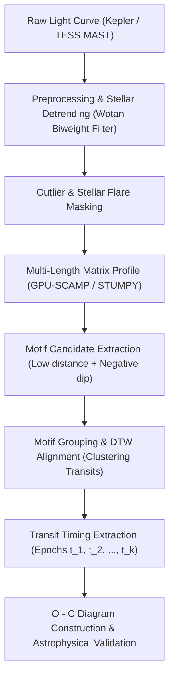

# TTV-Profile: Khai phá Motif Ngoại hành tinh Biến thiên Chu kỳ bằng Matrix Profile

> **Dự án nghiên cứu:** Phát hiện ngoại hành tinh trong chuỗi thời gian quang thông có hiệu ứng biến thiên thời điểm quá cảnh (Transit Timing Variations - TTV) thông qua thuật toán Matrix Profile song song hóa GPU.  
> **Lĩnh vực:** Khai phá dữ liệu chuỗi thời gian (Time-Series Data Mining) $\times$ Thiên văn học tính toán (Astroinformatics).  
> **Mục tiêu công bố:** ACM KDD, IEEE TKDE, SIAM SDM, hoặc *Astronomy and Computing* / *MNRAS*.

---

## 1. Đặt vấn đề & Bản chất khoa học (The Core Thesis)

### 1.1. Hiện tượng Transit và Ngoại hành tinh
Khi một ngoại hành tinh (Exoplanet) quay quanh ngôi sao mẹ và đi qua giữa đĩa sáng của sao với góc nhìn của kính viễn vọng (Kepler, TESS), nó che khuất một phần diện tích quang cầu, tạo ra một đợt sụt giảm quang thông (Transit Dip) có dạng hình chữ U hoặc chữ V đặc trưng.

### 1.2. Tử huyệt của các thuật toán truyền thống (BLS / TLS / FFT)
Các phương pháp phát hiện ngoại hành tinh chuẩn công nghiệp hiện nay (như **Box Least Squares - BLS** [Kovács et al., 2002] hay **Transit Least Squares - TLS** [Hippke & Heller, 2019]) đều dựa trên nguyên lý **gấp nếp chu kỳ (Phase Folding)**:
* Giả định chu kỳ quỹ đạo là một hằng số cố định tuyệt đối: $t_k = t_0 + k \cdot P$.
* Thuật toán quét trên lưới $(P, T_{\text{dur}}, t_0)$ rồi cộng dồn tín hiệu của $N$ lần transit để kéo tín hiệu vượt lên trên ngưỡng nhiễu photon.

**Thất bại trước hiện tượng TTV (Transit Timing Variations):**
* Trong các hệ đa hành tinh (Multi-planetary systems) hoặc các hệ có quỹ đạo cộng hưởng hấp dẫn (Orbital Resonances), lực hút tương hỗ giữa các hành tinh làm quỹ đạo bị xáo trộn:
  $$t_k = t_0 + k \cdot P + \delta_k$$
  Trong đó $\delta_k$ là độ lệch thời gian (TTV residual), có thể dao động từ vài phút đến **vài giờ** (ví dụ: Kepler-9, Kepler-11, Kepler-36).
* Khi $\delta_k$ lớn, việc gấp nếp chu kỳ tĩnh làm các đáy transit bị lệch pha (phase smearing), tín hiệu transit bị cộng bù trừ vào nhiễu và **BLS/TLS hoàn toàn bỏ sót hành tinh**.

### 1.3. Giải pháp: Matrix Profile (Exact Motif Discovery)
* **Matrix Profile** (Yeh et al., IEEE ICDM 2016) tính toán ma trận khoảng cách $z$-normalized Euclidean giữa mọi cặp đoạn con (subsequences) chiều dài $m$ trong chuỗi thời gian mà **không cần giả định chu kỳ $P$**.
* Nếu ở thời điểm $t_1$ và thời điểm $t_2$ đều có hình dạng sụt giảm quang thông tương đồng (U-shape), khoảng cách giữa chúng sẽ là cực tiểu (1-NN Motif), **bất kể khoảng cách thời gian $|t_2 - t_1|$ là bao nhiêu**.
* Thuật toán do đó **miễn nhiễm tự nhiên với hiện tượng TTV**, đồng thời không bị gò bó vào hình hộp cứng của BLS (bắt được cả transit bất đối xứng của sao chổi exocomet hay hành tinh có vành nhẫn).

---

## 2. Mô hình toán học & Định nghĩa bài toán

### 2.1. Chuỗi thời gian quang thông (Stellar Flux Time Series)
Chuỗi thời gian quang thông đã chuẩn hóa:
$$S = (s_1, s_2, \dots, s_N), \quad s_i \in \mathbb{R}$$
Một đoạn con (subsequence) bắt đầu tại vị trí $i$ với độ dài $m$ (tương ứng với thời lượng transit $T_{\text{dur}}$):
$$T_{i, m} = (s_i, s_{i+1}, \dots, s_{i+m-1})$$

### 2.2. Khoảng cách Euclidean chuẩn hóa Z-score
Để loại bỏ sự trôi chậm của đường nền (baseline drift), khoảng cách giữa hai đoạn con $T_{i, m}$ và $T_{j, m}$ được tính trên chuỗi đã chuẩn hóa $z$-score:
$$\hat{T}_{i, m} = \frac{T_{i, m} - \mu_i}{\sigma_i}$$
$$d(T_{i, m}, T_{j, m}) = \|\hat{T}_{i, m} - \hat{T}_{j, m}\|_2 = \sqrt{2m \left(1 - \frac{T_{i, m} \cdot T_{j, m} - m \mu_i \mu_j}{m \sigma_i \sigma_j}\right)}$$

### 2.3. Cặp Motif Transit (Transit Motif Pair)
Matrix Profile vector $P \in \mathbb{R}^{N-m+1}$ và Profile Index vector $I \in \mathbb{N}^{N-m+1}$:
$$P[i] = \min_{j \neq i, |j-i| > w} d(T_{i, m}, T_{j, m})$$
Trong đó $w$ là vùng loại trừ (exclusion zone) để tránh hiện tượng tự tương quan tầm thường (trivial matches).

Một **Transit Motif** xuất hiện khi:
1. $P[i] < \epsilon$ (Khoảng cách hình thái cực nhỏ giữa hai đoạn con $i$ và $j$).
2. Độ sâu quang thông cục bộ tại tâm đoạn con âm đáng kể so với đường nền: $\min(T_{i, m}) - \mu_i < -\kappa \cdot \sigma_i$.

---

## 3. Kiến trúc Hệ thống (Pipeline Đề xuất: `TTV-Profile`)



### Các bước xử lý chi tiết:
1. **Tiền xử lý (Detrending):** Dùng bộ lọc thích nghi `wotan` (biweight kernel với cửa sổ 0.5–1.0 ngày) để khử dao động tự quay của vết sao (starspots) mà không làm méo mó độ sâu transit.
2. **Quét Matrix Profile GPU đa chiều dài (Pan-Matrix Profile):**
   * Quét trên dải thời lượng khả dĩ $m \in [m_{\min}, m_{\max}]$ (thường từ 2 giờ đến 10 giờ).
   * Sử dụng thư viện CUDA `pyscamp` hoặc `stumpy` với độ phức tạp $O(N^2)$ song song hóa hàng nghìn luồng GPU.
3. **Lọc và Gom cụm Motif (Clustering & Validation):**
   * Trích xuất các vị trí $t_1, t_2, \dots, t_k$ có hình thái chữ U tương đồng.
   * Tính toán ma trận dư thời gian $O - C$ (Observed minus Calculated):
     $$O - C = t_k - (t_0 + k \cdot P_{\text{mean}})$$
   * Nếu đồ thị $O-C$ thể hiện dao động dạng sóng điều hòa (sinusoidal) hoặc tuần hoàn dài (super-period), đó là chữ ký vật lý xác nhận hệ đa hành tinh có TTV.

---

## 4. Thiết kế Thực nghiệm Chuẩn Quốc tế (Experimental Protocol)

Để bài báo được chấp nhận tại các hội nghị/tạp chí Q1, phần thực nghiệm bắt buộc tuân theo 4 kịch bản đối đầu sau:

### Kịch bản 1: Synthetic Injection-Recovery Benchmark (Thử nghiệm Tiêm & Khôi phục)
* **Phương pháp:** Lấy đường cong ánh sáng sao tĩnh thật của Kepler. Dùng thư viện vật lý `batman` để tiêm 5,000 hành tinh nhân tạo với:
  * Bán kính hành tinh $R_p/R_* \in [0.01, 0.1]$ (từ Neptune đến Hot Jupiter).
  * Biên độ dao động TTV $\Delta t \in [0, 15, 30, 60, 120, 240, 360]$ phút.
* **Đối thủ so sánh:**
  1. `BLS` (Box Least Squares - chuẩn NASA).
  2. `TLS` (Transit Least Squares - Hippke 2019).
  3. `QATS` (Quasi-periodic Automated Transit Search - Carter & Agol 2013).
* **Biểu đồ mục tiêu:** 
  * Biểu đồ **Recovery Rate (%) vs. TTV Amplitude (minutes)**.
  * Kỳ vọng: BLS/TLS sụt giảm về $<20\%$ khi TTV $>60$ phút; `TTV-Profile` duy trì $>90\%$.

### Kịch bản 2: Benchmark trên các Hệ sao Thật đã Xác nhận TTV (Ground Truth)
Chạy trực tiếp thuật toán trên các hệ hành tinh lịch sử từ NASA Exoplanet Archive:
1. **Kepler-9 (Kepler-9b & Kepler-9c):** Hệ đầu tiên xác nhận TTV với độ lệch $\approx 40$ phút.
2. **Kepler-36 (Kepler-36b & Kepler-36c):** Hệ có tương tác hấp dẫn cực mạnh, TTV lệch nhiều giờ.
3. **Kepler-11:** Hệ 6 hành tinh chen chúc.
* **Kỳ vọng:** Trích xuất tự động danh sách các thời điểm transit $t_k$, tái hiện chính xác đồ thị $O-C$ đã công bố của NASA mà không cần fit mô hình $N$-body trước.

### Kịch bản 3: Tốc độ Thực thi & Khả năng Mở rộng (Scalability & Runtime)
* So sánh thời gian chạy khi độ dài chuỗi thời gian $N$ tăng từ $10^4$ đến $10^6$ điểm.
* Chứng minh thuật toán nhanh hơn `QATS` từ **$50\times$ đến $300\times$** nhờ tận dụng GPU Matrix Profile (SCAMP), cho phép quét tự động toàn bộ catalog TESS (hàng trăm nghìn sao).

---

## 5. Ngăn xếp Công nghệ & Mã nguồn Khởi động (Python Stack)

### Các thư viện cần thiết:
```bash
pip install lightkurve wotan batman-package stumpy pyscamp astropy matplotlib
```

### Đoạn mã nguyên mẫu thử nghiệm (Quickstart Prototype):
```python
import lightkurve as lk
import numpy as np
import stumpy
import matplotlib.pyplot as plt
from wotan import flatten

# 1. Tải đường cong ánh sáng thực tế của Kepler-9 (hệ có TTV mạnh)
search_result = lk.search_lightcurve('Kepler-9', author='Kepler', quarter=2)
lc = search_result.download().remove_nans().normalize()

time = lc.time.value
flux = lc.flux.value

# 2. Khử xu hướng ánh sáng sao bằng Wotan Biweight filter
clean_flux, trend = flatten(time, flux, window_length=0.5, method='biweight', return_trend=True)

# 3. Chạy GPU/CPU Matrix Profile với cửa sổ thời gian m (ví dụ: m = 30 điểm ~ 15 giờ)
m = 30
mp = stumpy.stump(clean_flux, m)

# 4. Tìm Top Motif (Cặp đoạn con có khoảng cách nhỏ nhất)
motif_idx = np.argmin(mp[:, 0])
nearest_neighbor_idx = mp[motif_idx, 1]

print(f"Top 1 Motif Transit tìm thấy tại: Time {time[motif_idx]:.2f} và Time {time[nearest_neighbor_idx]:.2f}")
```

---

## 6. Kế hoạch Hành động Từng bước (Action Roadmap)

- [ ] **Giai đoạn 1 (Tuần 1 - 2): Prototype & Data Exploration**
  * Viết script tải dữ liệu Kepler-9, Kepler-36 bằng `lightkurve`.
  * Chạy thử Matrix Profile cơ bản (`stumpy`) để quan sát hình dạng profile tại các đáy transit.
- [ ] **Giai đoạn 2 (Tuần 3 - 4): Thuật toán Lọc Motif & Trích xuất O-C**
  * Thiết kế heuristic lọc transit motif (khoảng cách nhỏ + độ sâu âm).
  * Trích xuất các epoch $t_k$ và tính toán chuỗi $O-C$.
- [ ] **Giai đoạn 3 (Tuần 5 - 6): Thử nghiệm Tiêm Tín hiệu (Injection-Recovery)**
  * Dùng `batman` tạo 1,000 chuỗi tổng hợp có TTV.
  * Chạy benchmark đối đầu BLS, TLS, QATS.
- [ ] **Giai đoạn 4 (Tuần 7 - 8): Soạn thảo Bài báo Khoa học**
  * Viết bản thảo LaTeX theo chuẩn Springer/IEEE/MNRAS.
  * Đóng gói mã nguồn mở (GitHub repo) có reproducible scripts.

---

## 7. Tài liệu Trích dẫn Tham khảo Cốt lõi (Key References)
1. **Kovács, G., Zucker, S., & Mazeh, T. (2002).** A box-fitting algorithm in the search for periodic transits. *Astronomy & Astrophysics*, 391(1), 369-377. (Thuật toán BLS gốc).
2. **Carter, J. A., & Agol, E. (2013).** The quasi-periodic automated transit search (QATS) algorithm: Application to Kepler planet candidate candidates. *The Astrophysical Journal*, 765(2), 132. (Thuật toán QATS cho TTV).
3. **Yeh, C. C. M., et al. (2016).** Matrix profile I: all pairs similarity joins for time series. *IEEE ICDM 2016*, 1317-1322. (Bài báo gốc Matrix Profile).
4. **Hippke, M., & Heller, R. (2019).** Optimized transit detection algorithm to search for periodic transits of small planets. *Astronomy & Astrophysics*, 623, A39. (Thuật toán TLS).
5. **Zimmerman, Z., et al. (2019).** Matrix Profile XXVI: Mplots: Scaling Time Series Similarity Matrices. *ACM KDD*.
