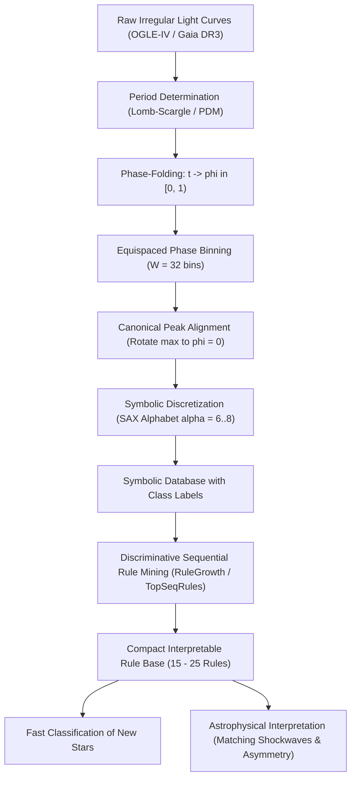

# Star-SAX-Rules: Phân loại Sao Biến quang Tường minh bằng Chuỗi Pha SAX và Luật Tuần tự

> **Dự án nghiên cứu:** Phân loại sao biến quang (Variable Star Classification) có khả năng giải thích vật lý (Interpretable / Explainable AI) thông qua rời rạc hóa chuỗi pha SAX (Phase-Folded SAX) và khai phá luật tuần tự phân biệt (Discriminative Sequential Rule Mining).  
> **Lĩnh vực:** Khai phá tri thức biểu tượng (Symbolic Knowledge Discovery) $\times$ Vật lý thiên văn sao (Stellar Astrophysics).  
> **Mục tiêu công bố:** IEEE TKDE, ACM TKDD, Applied Intelligence, hoặc *Astronomy and Computing* / *MNRAS*.

---

## 1. Đặt vấn đề & Bản chất khoa học (The Core Thesis)

### 1.1. Thực trạng: Cuộc khủng hoảng "Hộp đen" (The Black-Box Crisis)
* Các khảo sát bầu trời quy mô lớn như **OGLE-IV**, **Gaia DR3**, **ZTF**, và sắp tới là **Vera C. Rubin (LSST)** ghi nhận hàng triệu ngôi sao biến quang (Cepheids, RR Lyrae, Eclipsing Binaries, Miras).
* Hiện tại, các nhà thiên văn chủ yếu dựa vào:
  1. Trích xuất 60–100 đặc trưng tĩnh (Fourier coefficients $R_{21}, \phi_{21}$, Stetson index, skewness, kurtosis).
  2. Nạp vào các mô hình học máy "hộp đen": **Random Forest, XGBoost, hoặc Mạng nơ-ron tích chập 1D (CNN)**.
* **Hạn chế lớn:** Các mô hình này đạt độ chính xác cao nhưng **hoàn toàn thiếu tính diễn giải vật lý (Not Interpretable)**. Nhà thiên văn không thể liên kết trọng số ma trận hay hàng trăm cây quyết định phức tạp với các phương trình thủy động lực học và nhiệt động lực học trong lõi sao.

### 1.2. Giải pháp: Rời rạc hóa SAX trên Chuỗi pha & Khai phá Luật Tuần tự
* Đưa bài toán trở về bản chất hình thái học trực quan: Hình thái sóng quang thông của một ngôi sao biến quang phản ánh trực tiếp cơ chế dao động cơ học của nó.
* **Chuỗi ký tự SAX (Symbolic Aggregate approXimation):** Biến đường cong chu kỳ liên tục thành từ ngữ biểu tượng ngắn gọn (ví dụ: `a-b-e-f-d-b-a`).
* **Luật tuần tự phân biệt (Discriminative Sequential Rules):** Trích xuất các quy tắc nhân quả logic tường minh:
  $$\text{Rule: } [a \to e] \wedge [e \to b] \implies \text{RRab Lyrae} \quad (\text{Confidence: } 97.4\%, \text{Lift: } 8.2)$$
* **Ý nghĩa vật lý:** Luật trên diễn giải rằng: *"Quang thông tăng vọt từ đáy ($a$) lên đỉnh ($e$) trong chỉ 15% đầu chu kỳ, rồi hạ dần từ từ về ($b$)"*. Đây chính là hình chiếu trực tiếp của **sóng xung kích cơ học từ cơ chế $\kappa$ (Eddington Valve / $\kappa$-mechanism)** làm dãn nở tầng đối lưu của sao RR Lyrae!

---

## 2. Điểm then chốt về Phương pháp luận (Critical Methodological Requirement)

### ⚠️ Lưu ý sống còn: KHÔNG áp dụng SAX trực tiếp lên chuỗi thời gian thô!
* Các kính thiên văn mặt đất quan sát sao cách quãng (irregular cadences: đêm này đo 1 điểm, 3 đêm sau đo 1 điểm, cách 2 tháng đo 1 điểm). Chuỗi thô có mật độ lấy mẫu không đều và chứa hàng trăm chu kỳ lặp lại hỗn độn.
* **Bắt buộc phải qua bước Gấp nếp chu kỳ (Phase-Folding):**
  1. Dùng thuật toán **Lomb-Scargle** hoặc **PDM (Phase Dispersion Minimization)** để tìm chu kỳ chính $P$.
  2. Đổi trục thời gian $t$ thành pha không thứ nguyên $\phi \in [0, 1)$:
     $$\phi_i = \frac{t_i - t_0}{P} \pmod 1$$
  3. Chia trục pha $\phi$ thành $W$ bins đều (ví dụ $W = 16$ hoặc $32$ bins) và lấy giá trị median quang thông trong mỗi bin.
  4. **Căn chỉnh pha chuẩn tắc (Canonical Peak Alignment):** Tịnh tiến pha sao cho điểm cực đại (hoặc cực tiểu) luôn nằm tại $\phi = 0$ để tránh hiện tượng hoán vị vòng quanh của chuỗi ký tự SAX.
  5. Khi đó, mỗi ngôi sao được đại diện bằng đúng **MỘT chu kỳ chuẩn hóa hoàn hảo**. Áp dụng SAX trên chu kỳ này sẽ tạo ra một chuỗi ký tự có tính so sánh tuyệt đối giữa các ngôi sao.

---

## 3. Mô hình toán học & Định nghĩa Bài toán

### 3.1. Rời rạc hóa SAX trên Chuỗi pha (Phase-SAX)
Cho chuỗi pha binned $C = (c_1, c_2, \dots, c_W)$.
1. Chuẩn hóa $z$-score: $\hat{C} = \frac{C - \mu_C}{\sigma_C}$.
2. Chia thành $w$ đoạn PAA (Piecewise Aggregate Approximation).
3. Ánh xạ vào bảng chữ cái $\Sigma$ có kích thước $\alpha$ dựa trên các điểm phân vị chuẩn Gauss (Gaussian breakpoints $\beta_1, \beta_2, \dots, \beta_{\alpha-1}$):
   $$\operatorname{SAX}(\hat{C}) = (s_1, s_2, \dots, s_w), \quad s_k \in \Sigma = \{a, b, c, d, \dots\}$$

### 3.2. Luật tuần tự phân biệt (Discriminative Sequential Rule)
Cho tập cơ sở dữ liệu các chuỗi SAX $\mathcal{D} = \{(S_k, y_k)\}$, trong đó $y_k \in \mathcal{Y} = \{\text{Cepheid}, \text{RRab}, \text{RRc}, \text{Eclipsing}, \dots\}$ là nhãn phân lớp sao.
* Một luật tuần tự có dạng:
  $$r: X \Rightarrow Y \implies \text{Class } C$$
  Trong đó $X, Y$ là các mẫu con ký tự thỏa mãn $X$ xuất hiện trước $Y$ trong chuỗi SAX.
* **Độ hỗ trợ (Support):** Tỷ lệ các sao lớp $C$ chứa mẫu $X \to Y$.
* **Độ tin cậy (Confidence):**
  $$\operatorname{conf}(r) = \frac{|\{S \in \mathcal{D}_C \mid X \to Y \subseteq S\}|}{|\{S \in \mathcal{D} \mid X \to Y \subseteq S\}|}$$
* **Hệ số phân biệt (Information Gain / Contrast Lift):** Đảm bảo luật chỉ xuất hiện áp đảo ở lớp $C$ và hiếm khi xuất hiện ở các lớp sao khác.

---

## 4. Kiến trúc Hệ thống (`Star-SAX-Rules` Pipeline)



---

## 5. Thiết kế Thực nghiệm Chuẩn Quốc tế (Experimental Protocol)

### Kịch bản 1: Benchmark Độ chính xác Phân loại (Classification Accuracy & F1-Score)
* **Tập dữ liệu Vàng:** **OGLE-IV Variable Stars Catalog** (Hơn 400,000 sao biến quang trong Đám mây Magellan và Dải Ngân Hà, đã được các nhà thiên văn học phân loại thủ công chuẩn 100%):
  * Lớp 1: Classical Cepheids ($\delta$ Cephei).
  * Lớp 2: Type II Cepheids (W Virginis).
  * Lớp 3: RR Lyrae kiểu RRab (Bất đối xứng lớn, chu kỳ cơ bản).
  * Lớp 4: RR Lyrae kiểu RRc (Dạng sóng sin đều, họa âm bậc một).
  * Lớp 5: Sao đôi che nhau (Eclipsing Binaries: EA, EB, EW).
* **Đối thủ cạnh tranh (Baselines):**
  1. `Random Forest` + 60 đặc trưng Fourier/Stetson (Chuẩn kinh điển Richards et al., Kim et al.).
  2. `1D-CNN` (AstroNet / Deep-Variable-Star).
  3. `Decision Tree (CART)` và `RIPPER` (Rule-based truyền thống).
* **Kỳ vọng:** `Star-SAX-Rules` chỉ cần **15 – 25 luật logic** mà vẫn đạt F1-score $>93\%$, tiệm cận Random Forest hộp đen nhưng vượt trội hoàn toàn về tính minh bạch.

### Kịch bản 2: Đánh giá Tính giải thích Vật lý (Astrophysics Interpretability Audit)
* Trích xuất các luật hàng đầu và đối chiếu trực tiếp với lý thuyết xung động sao:
  * **Trường hợp RRab:** Chứng minh luật bắt được tỷ lệ thời gian dâng quang thông (Rise Time $\approx 0.15$) so với thời gian giảm ($0.85$).
  * **Trường hợp Sao đôi che nhau (Eclipsing Binaries):** Chứng minh luật bắt được cấu trúc "2 đáy lõm" khác độ sâu (Primary Eclipse và Secondary Eclipse).
  * Mời các chuyên gia thiên văn học đánh giá tính hợp lý của các luật logic (Domain Expert Evaluation).

### Kịch bản 3: Tốc độ Suy diễn & Độ nén Tri thức (Efficiency & Model Size)
* **Kích thước mô hình:** Tập luật chỉ vài Kilobytes (dễ dàng nhúng vào vi điều khiển hoặc pipeline biên edge-computing của kính thiên văn), so với hàng trăm Megabytes của Deep Neural Networks.
* **Thời gian phân loại:** Tốc độ so khớp ký tự chuỗi nhanh hơn $50\times - 100\times$ so với việc tính toán 60 hệ số Fourier phức tạp.

---

## 6. Ngăn xếp Công nghệ & Mã nguồn Khởi động (Python Stack)

### Cài đặt môi trường:
```bash
pip install lightkurve astropy pyts numpy matplotlib spmf
```

### Script nguyên mẫu thử nghiệm (Gấp nếp pha và chuyển đổi SAX):
```python
import numpy as np
import matplotlib.pyplot as plt
from astropy.timeseries import LombScargle
from pyts.approximation import SymbolicAggregateApproximation

# 1. Giả lập một đường cong ánh sáng sao RR Lyrae (dạng sóng bất đối xứng)
np.random.seed(42)
t = np.sort(np.random.uniform(0, 30, 200))  # Lấy mẫu không đều trong 30 ngày
true_period = 0.567  # Chu kỳ 0.567 ngày (~13.6 giờ)

# Dạng sóng răng cưa bất đối xứng (đặc trưng của RR Lyrae RRab)
phase_true = (t % true_period) / true_period
flux = 1.0 + 0.4 * np.sin(2 * np.pi * phase_true) - 0.2 * np.sin(4 * np.pi * phase_true)
flux += np.random.normal(0, 0.05, len(t))  # Thêm nhiễu quan sát

# 2. Tìm chu kỳ bằng Lomb-Scargle
frequency, power = LombScargle(t, flux).autopower(minimum_frequency=1.0, maximum_frequency=5.0)
best_period = 1.0 / frequency[np.argmax(power)]
print(f"Chu kỳ tìm được: {best_period:.4f} ngày (Thực tế: {true_period:.4f} ngày)")

# 3. Gấp nếp thời gian thành trục pha phi in [0, 1)
phase = (t % best_period) / best_period

# 4. Chia 16 phase bins và tính median quang thông
n_bins = 16
bin_edges = np.linspace(0, 1, n_bins + 1)
binned_flux = np.zeros(n_bins)
for i in range(n_bins):
    mask = (phase >= bin_edges[i]) & (phase < bin_edges[i+1])
    binned_flux[i] = np.median(flux[mask]) if np.any(mask) else 1.0

# 5. Căn chỉnh đỉnh cực đại về vị trí pha phi = 0 (Canonical Alignment)
max_idx = np.argmax(binned_flux)
canonical_flux = np.roll(binned_flux, -max_idx)

# 6. Chuyển đổi thành chuỗi ký tự SAX (Bảng chữ cái 6 ký tự: a, b, c, d, e, f)
sax = SymbolicAggregateApproximation(n_bins=6, strategy='normal')
sax_word = sax.fit_transform(canonical_flux.reshape(1, -1))[0]
sax_string = "".join(sax_word)

print(f"Chuỗi ký tự SAX đại diện cho ngôi sao: '{sax_string}'")
# Ví dụ kết quả: 'fedcbaaabbcddeef' -> thể hiện rõ từ đỉnh f giảm dần về a rồi vọt ngược lại
```

---

## 7. Kế hoạch Hành động Từng bước (Action Roadmap)

- [ ] **Giai đoạn 1 (Tuần 1 - 2): Khảo sát & Chuẩn bị Dữ liệu OGLE-IV**
  * Tải tập mẫu 5,000 sao biến quang thuộc 4 lớp (Cepheid, RRab, RRc, Eclipsing) từ kho dữ liệu mở OGLE-IV.
  * Hoàn thiện hàm gấp nếp pha chuẩn hóa và căn chỉnh đỉnh cực đại.
- [ ] **Giai đoạn 2 (Tuần 3 - 4): Triển khai Khai phá Luật Tuần tự**
  * Tích hợp thuật toán RuleGrowth hoặc TopSeqRules (dùng SPMF hoặc thư viện Python).
  * Viết hàm trích xuất luật tuần tự phân biệt và đánh giá theo Information Gain / Chi-square.
- [ ] **Giai đoạn 3 (Tuần 5 - 6): Thử nghiệm Đối đầu Toàn diện**
  * Chạy đối đầu Random Forest (Fourier features), 1D-CNN và Decision Tree.
  * Đo đạc Confusion Matrix, F1-Score, thời gian huấn luyện và thời gian suy diễn.
- [ ] **Giai đoạn 4 (Tuần 7 - 8): Soạn thảo Bài báo Khoa học**
  * Soạn thảo bản thảo LaTeX nhấn mạnh vào tính chất **Explainable AI (XAI)** cho thiên văn học.
  * Đối chiếu các luật sinh ra với các phương trình vật lý xung động sao.

---

## 8. Tài liệu Tham khảo Cốt lõi (Key References)
1. **Lin, J., Keogh, E., Lonardi, S., & Chiu, B. (2003).** A symbolic representation of time series, with implications for streaming algorithms. *ACM SIGMOD Workshop on Research Issues in Data Mining and Knowledge Discovery (DMKD)*, 2-11. (Bài báo gốc về SAX).
2. **Fournier-Viger, P., et al. (2012).** RuleGrowth: mining sequential rules common to several sequences by pattern-growth. *ACM SAC*, 1715-1720. (Thuật toán khai phá luật tuần tự RuleGrowth).
3. **Soszyński, I., et al. (2014).** The Optical Gravitational Lensing Experiment. The OGLE-IV Variable Star Catalog. *Acta Astronomica*, 64, 177. (Tập dữ liệu chuẩn mực OGLE-IV).
4. **Richards, J. W., et al. (2011).** On machine-learned classification of variable stars with sparse and irregularly sampled light curves. *The Astrophysical Journal*, 733(1), 10. (Bài báo kinh điển về phân loại sao bằng Random Forest + Fourier).
5. **Kim, D. W., & Bailer-Jones, C. A. (2016).** A package for the automated classification of periodic variable stars. *Astronomy & Astrophysics*, 587, A18.
